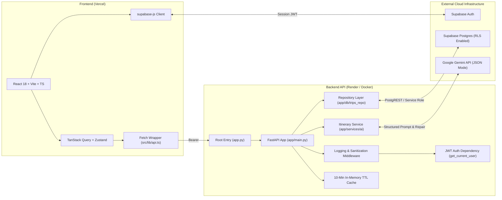
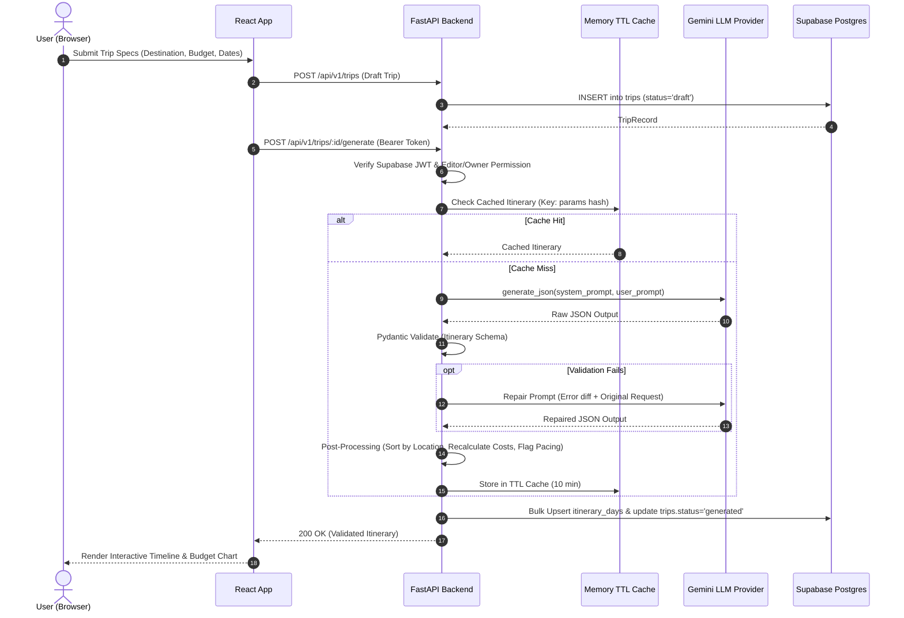
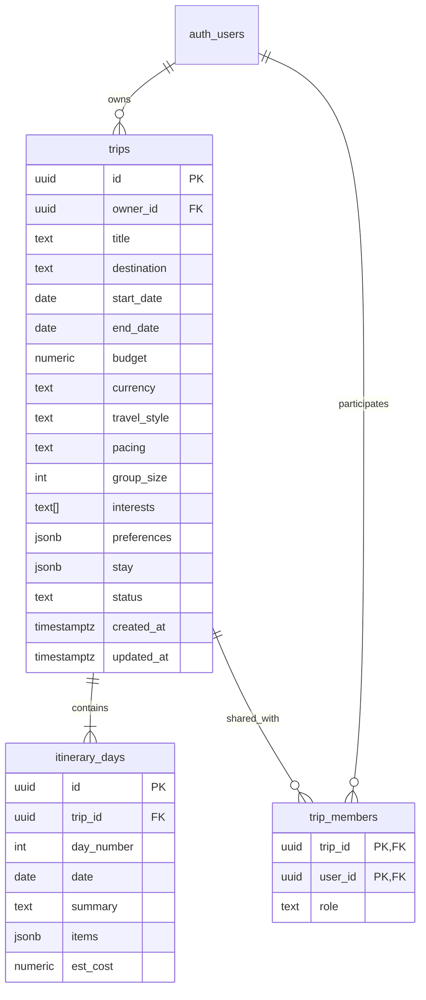

# Personalized Travel Itinerary Planner

[](https://github.com/your-org/travel-planner/actions)
[](https://react.dev/)
[](https://www.typescriptlang.org/)
[](https://fastapi.tiangolo.com/)
[](https://docs.pydantic.dev/)
[](https://supabase.com/)
[](https://ai.google.dev/)
[](LICENSE)

A production-ready full-stack AI web application that crafts structured, optimized, day-by-day travel itineraries. Built with strict Pydantic v2 validation, an LLM repair loop, Row Level Security (RLS) in Supabase Postgres, drag-and-drop itinerary customization, and real-time category budget visualizations.

---

## 🚀 Live Demo

- **Live Web App**: [https://your-travel-planner.vercel.app](https://your-travel-planner.vercel.app) *(Deploy URL placeholder)*
- **Interactive API Docs (Swagger UI)**: [https://travel-planner-api.onrender.com/docs](https://travel-planner-api.onrender.com/docs)
- **Instant Demo Account**:
  - Click **"⚡ Try Demo Account"** on the `/login` screen to automatically fill credentials.
  - Or manually sign in with:
    - **Email**: `demo@travelplanner.local`
    - **Password**: `DemoPlanner123!`
  - Pre-seeded with 2 fully generated sample trips (Weekend Solo Trip to Goa & 5-Day Couple Trip to Udaipur & Mount Abu).
- **⏱️ Note on Cold Starts**: The backend is hosted on Render's free tier, which sleeps after inactivity. The first request may take ~30 seconds to wake up; the frontend displays a banner and auto-retries smoothly.

---

## 1. Problem Statement & User Scenarios

Travel planning often suffers from information overload, unrealistic transit estimates, and budget surprises. Traditional tools lack geographic proximity optimization and don't gracefully handle spontaneous itinerary edits.

- **Scenario 1: Solo Backpacker ("Relaxed Explorer")**
  - Wants a relaxed pace (3–4 activities/day), low budget, and focus on culture and street food. The planner clusters nearby sights to eliminate backtracking and provides authentic local meals.
- **Scenario 2: Couple ("Balanced Romantic Getaway")**
  - Requires moderate pacing (4–5 activities/day), boutique stays, and flexible dining reservations. They can regenerate individual days (e.g. "Focus on sunset boat rides") without altering the rest of their trip.
- **Scenario 3: Group of Friends ("Packed Sightseeing & Nightlife")**
  - 4 to 8 travelers with packed days (5–6 sights/day) and shared expense tracking. The owner invites collaborators via email as editors or viewers, with server-side and database-level access checks.

---

## 2. Key Features

- **Multi-Step Trip Builder**: Zod-validated 4-step wizard (Destination & Dates, Budget & Pacing, Style & Interests, Review).
- **Provider-Agnostic AI Engine**: Clean LLM abstraction with native support for Google Gemini (`gemini-2.5-flash`), temperature control, and JSON mode.
- **Schema Validation & Self-Healing**: Strict Pydantic v2 schema enforcement with automatic repair retry on malformed outputs, failing gracefully with standardized 502 errors.
- **Geographic Proximity Optimization**: Post-processing pass groups same-area activities together and calculates transit times (0m first, 5m intra-area, 20m cross-area).
- **Cost Recalculation Engine**: Recomputes all day and trip costs from activity items rather than trusting raw LLM math, flagging over-budget itineraries.
- **Interactive Itinerary Studio**:
  - Vertical timeline with day navigation tabs.
  - Drag-and-drop activity reordering powered by `@dnd-kit`.
  - Inline activity editing (title, cost, description) and deletion.
  - Single-day AI regeneration with contextual awareness of other days.
- **Budget Analytics**: Category breakdown pie chart (attractions, dining, transport, stay, activities) powered by Recharts.
- **Group Collaboration**: Invite group members via email with role permissions (`editor` or `viewer`).
- **Security & Hardening**:
  - Supabase HS256 JWT verification on every request.
  - Row Level Security (RLS) policies on `trips`, `itinerary_days`, and `trip_members`.
  - Rate limiting via SlowAPI (5/min for full generate, 10/min for single day).
  - Prompt injection sanitization stripping adversarial control tokens.
  - Structured request logging with `X-Request-ID` and timing headers.

---

## 3. Architecture

### Component Diagram



### Request Flow: Generate Itinerary



---

## 4. Data Model

### Entity-Relationship Diagram



---

## 5. AI Design & Guardrails

- **System Prompt Guardrails**: Strictly commands realistic scheduling, authentic local dining, pacing activity counts, and geographic clustering.
- **Pydantic Validation**: All outputs validate against [`Itinerary`](file:///home/unyx/Code/Travel/backend/app/schemas/itinerary.py), [`DayPlan`](file:///home/unyx/Code/Travel/backend/app/schemas/itinerary.py), and [`Activity`](file:///home/unyx/Code/Travel/backend/app/schemas/itinerary.py).
- **Self-Healing Loop**: If validation fails, `validate_and_repair` formats a structured correction prompt explaining the validation error. On a second failure, a clean `502 AI_SCHEMA_VALIDATION_FAILED` is returned.
- **Math Verification**: Activity costs are summed programmatically to establish `day_total_cost` and `total_estimated_cost` with accommodation nights.
- **Day-Level Regeneration**: When regenerating a specific day, the remaining days are passed into the prompt to guarantee non-overlapping attractions.

---

## 6. API Reference

All routes require authentication (`Authorization: Bearer <token>`) except `/health`. Standard error format: `{"error": {"code": str, "message": str}}`.

| Method | Path | Auth | Purpose |
| :--- | :--- | :--- | :--- |
| `GET` | `/health` | Public | Health and uptime status check |
| `GET` | `/api/me` | Bearer | Returns the authenticated `user_id` from token |
| `POST` | `/api/v1/trips` | Bearer | Create trip draft with validated parameters |
| `GET` | `/api/v1/trips` | Bearer | List trips owned by or shared with current user |
| `GET` | `/api/v1/trips/{id}` | Bearer | Retrieve trip metadata (owner or member) |
| `PATCH` | `/api/v1/trips/{id}` | Bearer | Update trip metadata (owner only) |
| `DELETE` | `/api/v1/trips/{id}` | Bearer | Delete trip (owner only) |
| `POST` | `/api/v1/trips/{id}/generate` | Bearer | Generate full itinerary via AI & persist days |
| `POST` | `/api/v1/trips/{id}/days/{n}/regenerate` | Bearer | Regenerate single day with contextual prompt |
| `PATCH` | `/api/v1/trips/{id}/days/{n}` | Bearer | Manual edit of day activities & cost recalc |
| `POST` | `/api/v1/trips/{id}/members` | Bearer | Add trip member by email and role (owner only) |
| `DELETE` | `/api/v1/trips/{id}/members/{user_id}` | Bearer | Remove trip member (owner only) |
| `GET` | `/api/v1/trips/{id}/summary` | Bearer | Budget breakdown by category (attraction, dining, etc.) |

---

## 7. Repository Structure

```text
.
├── app.py                     # Root execution entry point (uvicorn app:app / python app.py)
├── requirements.txt           # Pinned production runtime dependencies
├── requirements-dev.txt       # Development and test dependencies
├── render.yaml                # Render deployment blueprint
├── LICENSE                    # MIT License
├── .gitignore                 # Production hygiene rules
├── frontend/                  # React 18 + Vite + TypeScript Frontend
│   ├── src/
│   │   ├── components/        # Layout, ActivityCard, BudgetPanel, ShareModal, Toasts
│   │   ├── pages/             # Login, Signup, Dashboard, NewTrip, TripDetail
│   │   ├── store/             # Zustand auth and UI stores
│   │   ├── lib/               # Typed supabase-js and api fetch wrappers
│   │   └── types/             # Shared TypeScript schemas
│   ├── e2e/                   # Playwright end-to-end tests
│   ├── vite.config.ts         # Vite and Vitest configuration
│   └── vercel.json            # Vercel SPA routing rewrites
├── backend/                   # Python 3.11 FastAPI Backend
│   ├── app/
│   │   ├── api/               # API routes (/health, /trips) & auth dependencies
│   │   ├── core/              # Config, HS256 auth, error handlers, rate-limiting, cache
│   │   ├── db/                # Supabase client & trips repository layer
│   │   ├── schemas/           # Pydantic models for DB, API, and Itinerary
│   │   ├── services/ai/       # Gemini provider, prompts, and itinerary service
│   │   └── scripts/           # CLI test generator script
│   ├── tests/                 # Pytest test suite (auth, repo, AI service, routes)
│   └── Dockerfile             # Production container definition
├── supabase/
│   └── migrations/
│       └── 001_init.sql       # Postgres schema, indexes, triggers, and RLS policies
└── docs/
    ├── ARCHITECTURE.md        # Architecture overview & component diagram
    ├── DEPLOY.md              # Detailed cloud deployment runbook
    ├── openapi.json           # Exported OpenAPI 3.1 schema
    └── screenshots/           # Application screenshots
```

---

## 8. Setup & Running Locally

### Prerequisites
- Python 3.11+
- Node.js 18+ and npm
- A free [Supabase](https://supabase.com) project
- A [Google Gemini API Key](https://ai.google.dev/)

### 1. Database Migration
Open your Supabase SQL editor and execute [`supabase/migrations/001_init.sql`](file:///home/unyx/Code/Travel/supabase/migrations/001_init.sql).

### 2. Backend Setup (`Root`)

#### Linux / macOS
```bash
python3 -m venv .venv
source .venv/bin/activate
pip install -r requirements.txt
cp backend/.env.example .env
# Edit .env with your SUPABASE_URL, SUPABASE_JWT_SECRET, and GEMINI_API_KEY
python app.py
```

#### Windows (PowerShell)
```powershell
python -m venv .venv
.\.venv\Scripts\Activate.ps1
pip install -r requirements.txt
Copy-Item backend\.env.example .env
# Edit .env with your credentials
python app.py
```
*Health check:* `curl http://localhost:8000/health` (returns `{"status":"ok"}`).

### 3. Frontend Setup (`/frontend`)

```bash
cd frontend
npm install
cp .env.example .env
# Set VITE_API_BASE_URL=http://localhost:8000
npm run dev
```
Open `http://localhost:5173`.

---

## 9. Testing

```bash
# 1. Backend Pytest Suite (20 tests passing)
cd backend
.venv/bin/pytest -v

# 2. Frontend Vitest Suite (Unit tests)
cd frontend
npx vitest run

# 3. Frontend Lint & Typecheck
cd frontend
npm run lint

# 4. Backend Lint Check
ruff check backend/app backend/tests app.py
```

---

## 10. Deployment

Refer to [`docs/DEPLOY.md`](file:///home/unyx/Code/Travel/docs/DEPLOY.md) for full instructions:
- **Backend on Render**: Uses `render.yaml` and `backend/Dockerfile` with health check `/health`.
- **Frontend on Vercel**: Uses Vite preset and `frontend/vercel.json` SPA rewrites.
- **Supabase**: Hosts Postgres database, HS256 auth tokens, and executes RLS policies.

---

## 11. Project Objectives Mapping

| # | Project Objective | Implementing Files / Components |
|---|---|---|
| 1 | Monorepo layout & root entry | `app.py`, `frontend/`, `backend/`, `supabase/`, `README.md` |
| 2 | Supabase DB, RLS & triggers | `supabase/migrations/001_init.sql` (`trips`, `itinerary_days`, `trip_members`) |
| 3 | Supabase JWT & authorization | `backend/app/core/auth.py`, `backend/app/api/deps.py`, `backend/app/db/trips_repo.py` |
| 4 | Provider-agnostic AI wrapper | `backend/app/services/ai/provider.py`, `gemini_provider.py`, `prompts.py` |
| 5 | Pydantic schema & repair retry | `backend/app/schemas/itinerary.py`, `backend/app/services/ai/itinerary_service.py` |
| 6 | Geographic sorting & cost math | `backend/app/services/ai/itinerary_service.py` (`optimize_day_geographic_order`, `post_process_itinerary`) |
| 7 | Authenticated REST API & limits | `backend/app/api/routes/trips.py`, `backend/app/core/limiter.py`, `docs/openapi.json` |
| 8 | React SaaS dashboard & auth | `frontend/src/pages/DashboardPage.tsx`, `LoginPage.tsx`, `SignupPage.tsx`, `authStore.ts` |
| 9 | Smart trip builder & timeline | `frontend/src/pages/NewTripPage.tsx`, `TripDetailPage.tsx`, `ActivityCard.tsx` (`@dnd-kit`), `BudgetSummaryPanel.tsx` (`recharts`) |
| 10 | CI/CD, hardening & deployment | `.github/workflows/ci.yml`, `backend/app/core/sanitizer.py`, `logging_middleware.py`, `cache.py`, `render.yaml`, `vercel.json`, `docs/DEPLOY.md` |

---

## 12. Screenshots

| Dashboard Overview | Smart Trip Builder | Itinerary Studio |
| :---: | :---: | :---: |
|  |  |  |

---

## 13. Limitations & Future Work

- **Live Flight & Hotel Pricing**: Currently estimates costs and areas based on Gemini knowledge; future iterations can integrate Amadeus or Google Places APIs.
- **Offline Sync**: Offline trip caching through Progressive Web App (PWA) service workers.
- **Export to Calendar**: Download generated itineraries directly as `.ics` or sync to Google Calendar.

---

## 14. License

This project is licensed under the MIT License — see the [LICENSE](LICENSE) file for details.
