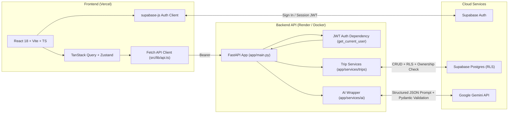

# Architecture Overview

## System Component Diagram

## Request & Data Flow

1. **Authentication (`React -> Supabase Auth`)**:
   - Users sign up or sign in via `supabase-js` (`src/lib/supabase.ts`).
   - Supabase issues an HS256-signed JWT access token stored in the client session.

2. **Authenticated API Request (`React -> FastAPI`)**:
   - The frontend calls `apiRequest()` (`src/lib/api.ts`), which retrieves the active session token from `supabase.auth.getSession()` and attaches `Authorization: Bearer <token>`.
   - Every protected FastAPI route depends on `get_current_user` (`app/core/auth.py`), which verifies the JWT signature using `SUPABASE_JWT_SECRET` (HS256) and extracts the `sub` claim as `user_id`.
   - Any missing, expired, or invalid token immediately returns `401` with `{"error": {"code": "...", "message": "..."}}`.

3. **Itinerary Generation (`FastAPI -> Gemini`)**:
   - Trip generation and single-day regeneration requests pass validated user parameters to the provider-agnostic AI service (`app/services/ai/`).
   - The AI service calls Google Gemini and validates the raw JSON output against strict Pydantic v2 schemas.
   - If validation fails, the service retries once with a repair prompt; if it fails again, FastAPI returns a clean `502` error in the standard error format.

4. **Persistence & Authorization (`FastAPI -> Supabase Postgres`)**:
   - The trip service (`app/services/trips/`) reads and writes trips, days, activities, and group memberships in Supabase Postgres.
   - Ownership and trip membership checks are enforced both in FastAPI business logic and at the database layer via Postgres Row Level Security (RLS) policies.
